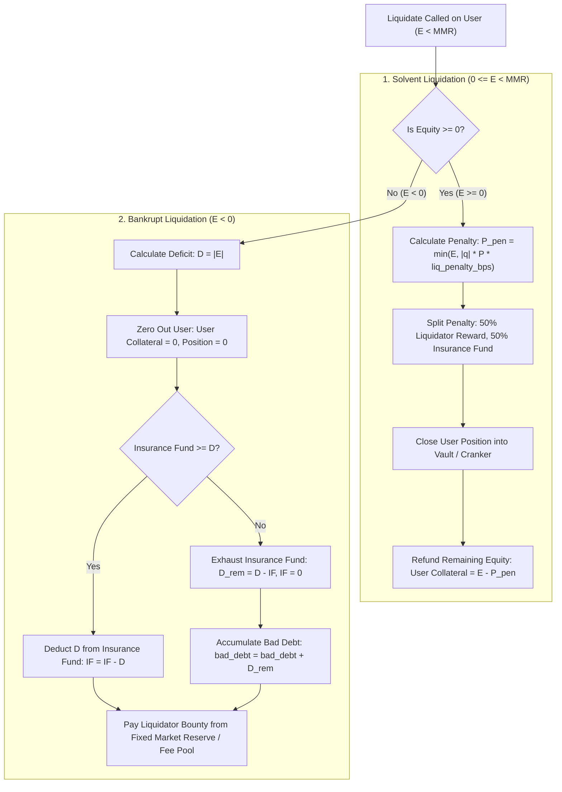
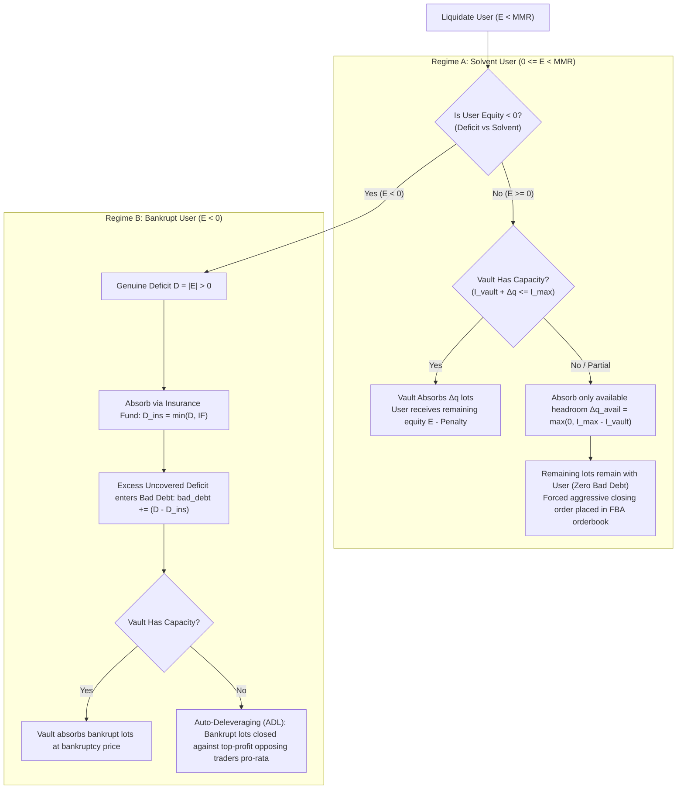

# Formal Specification: Bad-Debt Accounting & Liquidation Solvency (H-4)

**Document Version:** 1.0.0  
**Target Program:** `programs/epoch`  
**Classification:** Restricted Architectural Specification (Tier 3 Gate)  
**Author:** Lead Architect & Engineering Manager  
**Status:** PROPOSED FOR IMPLEMENTATION (Gated Pending Review)  

---

## 1. Executive Summary & Problem Definition

In perpetual futures protocols, price volatility or network congestion can cause a leveraged trader's margin ratio to drop below the Maintenance Margin Requirement ($\text{MMR}$) or even fall below zero equity ($\text{Equity} < 0$, bankruptcy). 

In Epoch Protocol:
1. **Current Vulnerability (H-4):** When a user account reaches negative equity ($\text{Equity} < 0$), attempting to liquidate or settle the position without formal bad-debt accounting creates an unbacked collateral hole in the collateral vault PDA. If the insurance fund has insufficient balance to absorb the deficit, the collateral vault becomes insolvent, violating the Global Collateral Conservation Invariant ($I-1$) and preventing solvent users from withdrawing their funds.
2. **Current Deficit Behavior:** The protocol lacks a dedicated `bad_debt` accumulator on `Market`, leaving insolvency untracked and risking `Underflow` / `MathOverflow` panics during close-out calculations.
3. **Capacity Constraints:** The Backstop Vault has finite lot absorption capacity (`max_inventory_lots`). Dumping an entire bankrupt position onto the vault in a single transaction can exceed vault risk limits or exhaust vault collateral.

This specification defines a rigorous, mathematically verified bad-debt accounting model supporting **partial liquidation**, **vault capacity limits**, **insurance fund absorption**, **explicit bad-debt tracking**, and **strict invariant conservation**.

---

## 2. Mathematical Model & State Definitions

### 2.1 State Variables (`Market` and `UserAccount`)

```rust
// On Market state (programs/epoch/src/state/market.rs)
pub struct Market {
    // ... existing fields ...
    pub fee_pool: u64,          // Protocol trading fee pool (micro-USDC)
    pub insurance_fund: u64,    // Liquidation penalty & backstop reserve (micro-USDC)
    pub bad_debt: u64,          // Cumulative unbacked insolvency deficit (micro-USDC)
    // ...
}

// On UserAccount state (programs/epoch/src/state/user.rs)
pub struct UserAccount {
    pub collateral: u64,        // Deposited USDC collateral (micro-USDC)
    pub base_position: i64,     // Net open position in lots (+ for long, - for short)
    pub entry_notional: i64,    // Cost basis in micro-USDC
    pub last_funding_index: i128, // Funding snapshot
    pub active_orders: u8,      // Count of open orders in batch rings
    // ...
}
```

### 2.2 Financial Invariants

#### Invariant I-1: Global Collateral Conservation
The total token balance held in the SPL Collateral Vault (`vault_balance`) must exactly match the sum of all liabilities, reserves, and debt:

$$\text{vault\_balance} = \sum_{i=1}^{N} \text{collateral}_i + \text{fee\_pool} + \text{insurance\_fund} - \text{bad\_debt}$$

Where:
- $\sum \text{collateral}_i$: Total margin deposited by all user accounts.
- $\text{fee\_pool}$: Accumulated protocol fees not yet withdrawn by governance.
- $\text{insurance\_fund}$: Dedicated buffer funded by liquidation penalties and capitalization.
- $\text{bad\_debt}$: Cumulative unhedged shortfall from bankrupt accounts where deficit exceeded available insurance reserves.

#### Invariant I-11: Solvency Conservation Under Liquidation
For any liquidation event closing $\Delta q$ lots of a position:
$$\Delta \text{vault\_balance} = 0$$
$$\Delta \left( \sum \text{collateral}_i + \text{fee\_pool} + \text{insurance\_fund} - \text{bad\_debt} \right) = 0$$

---

## 3. Account Health & Equity Evaluation

### 3.1 Valuation Formulae
Given:
- Oracle price $P$ (micro-USDC per lot, scaled by $10^6$)
- Cumulative market funding index $F_{\text{current}}$
- User position $q = \text{base\_position}$ (lots)
- User entry notional $N = \text{entry\_notional}$
- User funding snapshot $F_{\text{entry}} = \text{last\_funding\_index}$
- Deposited collateral $C = \text{collateral}$

#### Unrealized PnL ($\text{uPnL}$):
$$\text{uPnL} = \begin{cases} 
q \cdot P - N & \text{if } q > 0 \text{ (Long)} \\
|q| \cdot P_{\text{entry}} - |q| \cdot P = N - |q| \cdot P & \text{if } q < 0 \text{ (Short)} \\
0 & \text{if } q = 0 
\end{cases}$$

#### Accrued Funding ($\text{Funding}$):
$$\text{Funding} = \frac{q \cdot (F_{\text{current}} - F_{\text{entry}})}{\text{SCALE}}$$
*(Positive means funding owed to user; negative means funding owed by user).*

#### Total User Equity ($E$):
$$E = C + \text{uPnL} + \text{Funding}$$

#### Maintenance Margin Requirement ($\text{MMR}$):
$$\text{MMR} = \frac{|q| \cdot P \cdot \text{mmr\_bps}}{10\,000}$$

### 3.2 Liquidation Eligibility Conditions
An account is eligible for liquidation if and only if:
1. The user holds an open position: $|q| > 0$.
2. User equity is below maintenance margin: $E < \text{MMR}$.
3. Oracle price $P$ is fresh and valid (`posted_slot <= current_slot`, age $\le \text{max\_oracle\_age\_secs}$, confidence $\le \text{max\_conf\_bps}$).

---

## 4. Liquidation Mechanics: Two-Tier Processing

Liquidation bifurcates into two distinct mathematical regimes based on whether the account is **distressed but solvent** ($0 \le E < \text{MMR}$) or **bankrupt** ($E < 0$).



### 4.1 Regime 1: Distressed but Solvent ($0 \le E < \text{MMR}$)
The user has sufficient collateral to absorb their trading loss plus a liquidation penalty.

1. **Liquidation Penalty ($\text{Penalty}$):**
   $$\text{MaxPenalty} = \frac{|q| \cdot P \cdot \text{liq\_penalty\_bps}}{10\,000}$$
   $$\text{Penalty} = \min(E, \text{MaxPenalty})$$

2. **Penalty Allocation:**
   - **Liquidator Incentive ($50\%$):** $\text{Reward} = \lfloor \text{Penalty} / 2 \rfloor$ transferred to `liquidator.collateral`.
   - **Insurance Fund Contribution ($50\%$):** $\text{Reserve} = \text{Penalty} - \text{Reward}$ credited to `market.insurance_fund`.

3. **Position Liquidation:**
   - User's position $q$ is fully transferred to the Backstop Vault or closing counterparty.
   - User's `base_position` is set to $0$.
   - User's `entry_notional` is set to $0$.

4. **Residual Collateral:**
   - User's remaining collateral becomes $C_{\text{final}} = E - \text{Penalty} \ge 0$.
   - User remains solvent and may withdraw $C_{\text{final}}$.

### 4.2 Regime 2: Bankrupt Account ($E < 0$)
The user's trading losses exceed their deposited collateral. A deficit $D = |E| = -E > 0$ exists.

1. **User Zeroing:**
   - User's collateral is wiped: $C_{\text{final}} = 0$.
   - User's position is closed: $q_{\text{final}} = 0, N_{\text{final}} = 0$.

2. **Deficit Absorption Cascade:**
   - **Step 1 (Insurance Fund Drawdown):**
     If $\text{insurance\_fund} \ge D$:
     $$\Delta \text{insurance\_fund} = -D$$
     $$\Delta \text{bad\_debt} = 0$$
   - **Step 2 (Insolvency Spillover to Bad Debt):**
     If $\text{insurance\_fund} < D$:
     $$\text{Shortfall} = D - \text{insurance\_fund}$$
     $$\text{insurance\_fund} = 0$$
     $$\text{bad\_debt} = \text{bad\_debt} + \text{Shortfall}$$

3. **Liquidator Cranker Bounty:**
   - To prevent crankers from avoiding bankrupt liquidations, a flat protocol bounty (e.g., $5\text{ USDC} = 5\,000\,000\text{ micro-USDC}$) is paid to the liquidator from `market.fee_pool`. If `market.fee_pool` is insufficient, the bounty is credited as bad debt.

4. **Verification of Invariant I-1:**
   Prior to liquidation:
   $$\text{Liabilities} = (C - D) + \dots + \text{IF} - \text{BD} = C + \dots + \text{IF} - (\text{BD} + D)$$
   After liquidation:
   - User collateral is reduced from $C$ to $0$ ($\Delta C = -C$).
   - Net loss to system is $D$.
   - Insurance fund decreases by $\min(\text{IF}, D)$.
   - Bad debt increases by $\max(0, D - \text{IF})$.
   $$\Delta \text{Liabilities} = -C + (C - D) = 0$$
   The invariant holds exactly to the nearest micro-USDC without leakage.

---

## 5. Partial Liquidation & Vault Capacity Constraints

### 5.1 Motivation
Closing an extremely large position (e.g. 50,000 lots) in a single transaction can:
1. Exceed the Backstop Vault's lot limit: $\text{current\_inventory} + \Delta q > \text{max\_inventory\_lots}$.
2. Exceed compute unit budgets if multiple settlement iterations are required.

### 5.2 Partial Liquidation Step Size
Define the maximum liquidation fraction $\alpha = 50\%$ (5,000 bps) of the open position per liquidation step, unless the position is below a minimum lot threshold ($\le 100\text{ lots}$), in which case $100\%$ is closed.

$$\Delta q = \begin{cases}
|q| & \text{if } |q| \le 100 \\
\max\left(100, \left\lfloor \frac{|q|}{2} \right\rfloor \right) & \text{if } |q| > 100
\end{cases}$$

### 5.3 Proportional Accounting for Partial Liquidation
When closing $\Delta q < |q|$ lots:
1. **Realized Notional Fraction:**
   $$N_{\text{closed}} = \left\lfloor \frac{N \cdot \Delta q}{|q|} \right\rfloor$$
   $$N_{\text{remaining}} = N - N_{\text{closed}}$$
2. **Proportional Equity & Penalty:**
   PnL and funding for $\Delta q$ are realized and settled into user collateral.
   User retains $q_{\text{new}} = q - \text{sign}(q)\Delta q$ and $N_{\text{new}} = N_{\text{remaining}}$.

### 5.4 Backstop Inventory Saturation vs Financial Solvency: Handling Remaining Positions

A critical architectural distinction exists between **Market Maker Vault Inventory Limits** and **Account Equity Solvency**:
- **Vault Capacity** ($I_{\text{vault}} \le I_{\text{max}}$) is a structural inventory and risk constraint for the backstop vault.
- **Financial Solvency** is purely a property of user equity ($E = C + \text{uPnL} + \text{Funding}$).
- **Fundamental Rule:** A saturated vault ($I_{\text{vault}} + \Delta q > I_{\text{max}}$) does **NOT** indicate a financial deficit and must **NEVER** generate bad debt.

#### Detailed Position Handling Across Saturation Regimes:



1. **Regime A: Saturated Backstop with Solvent User ($0 \le E < \text{MMR}$)**
   - The user has positive equity ($E \ge 0$). Their position is simply under-collateralized relative to the maintenance margin threshold.
   - If the vault is saturated ($I_{\text{vault}} \ge I_{\text{max}}$):
     - The vault absorbs only up to available headroom: $\Delta q_{\text{avail}} = \max(0, I_{\text{max}} - I_{\text{vault}})$.
     - **Remaining Lots:** If $\Delta q_{\text{avail}} < \Delta q$, the unabsorbed lots remain in the user's account with proportional collateral.
     - **Zero Bad Debt Invariant:** Because $E \ge 0$, no deficit exists. **Protocol `bad_debt` is unchanged ($\Delta \text{bad\_debt} = 0$).**
     - **Secondary Liquidation Route:** The unabsorbed lots are placed into the next Frequent Batch Auction (FBA) clearing cycle as a priority market-on-close order to match against organic opposing liquidity.
     - **Insufficient Organic Liquidity Handling:** If organic bids/asks in the auction are insufficient, the order matches whatever volume is available pro-rata. Residual lots remain in `LIQUIDATION_LOCKED` status until subsequent auctions or until the user deposits collateral to restore $E \ge \text{MMR}$.
     - **Collateral Conservation ($I-1$):** Exactly preserved. All collateral remains in user and vault accounts.

2. **Regime B: Saturated Backstop with Bankrupt User ($E < 0$)**
   - The user has negative equity ($E < 0$). A **genuine uncovered deficit** $D = -E > 0$ exists.
   - **Financial Deficit Accounting:**
     - The deficit $D$ is debited from `market.insurance_fund`: $D_{\text{ins}} = \min(D, \text{insurance\_fund})$.
     - If $\text{insurance\_fund} < D$, the remaining deficit $D - D_{\text{ins}}$ is recorded in `market.bad_debt`.
     - User collateral is set to $0$.
   - **Inventory Handling Under Saturation:**
     - The vault takes lots up to $\Delta q_{\text{avail}}$.
     - For any lots that cannot enter the vault, the protocol invokes **Auto-Deleveraging (ADL)**.

### 5.5 Auto-Deleveraging (ADL) Protocol Specification & Bankruptcy Price Derivation

When bankrupt lots cannot be absorbed by the backstop vault, the protocol executes Auto-Deleveraging (ADL):

#### 1. First-Principles Derivation of Bankruptcy Price ($P_{\text{bk}}$)
The bankruptcy price $P_{\text{bk}}$ is defined as the exact oracle mark price at which the account's total equity equals zero:
$$\text{Equity}(P_{\text{bk}}) \equiv C + \text{uPnL}(P_{\text{bk}}) - \text{AccruedFunding} = 0$$

Where:
- $C$: Current deposited collateral (micro-USDC)
- $q$: Signed position in base lots ($q > 0$ for Long, $q < 0$ for Short)
- $N$: Entry notional in micro-USDC ($N = \frac{|q| \cdot P_{\text{entry}}}{1000}$)
- $\text{AccruedFunding} = \frac{q \cdot (F_{\text{current}} - F_{\text{snapshot}})}{F_{\text{SCALE}}}$

**Derivation for Long Position ($q > 0$):**
$$\text{uPnL}(P) = \frac{q \cdot P}{1000} - N$$
$$C + \frac{q \cdot P_{\text{bk}}^{\text{long}}}{1000} - N - \text{AccruedFunding} = 0$$
$$\frac{q \cdot P_{\text{bk}}^{\text{long}}}{1000} = N + \text{AccruedFunding} - C$$
$$P_{\text{bk}}^{\text{long}} = \frac{1000}{q} \cdot \left(N + \text{AccruedFunding} - C\right)$$

**Derivation for Short Position ($q < 0$):**
$$\text{uPnL}(P) = N - \frac{|q| \cdot P}{1000} = N + \frac{q \cdot P}{1000}$$
$$C + N + \frac{q \cdot P_{\text{bk}}^{\text{short}}}{1000} - \text{AccruedFunding} = 0$$
$$\frac{|q| \cdot P_{\text{bk}}^{\text{short}}}{1000} = N + C - \text{AccruedFunding}$$
$$P_{\text{bk}}^{\text{short}} = \frac{1000}{|q|} \cdot \left(N + C - \text{AccruedFunding}\right)$$

**Unified Analytical Representation:**
$$P_{\text{bk}} = \frac{1000}{|q|} \cdot \left(N - \text{sign}(q) \cdot (C - \text{AccruedFunding})\right)$$
*(Clamped to $\ge 0$). At true bankruptcy where collateral is exhausted prior to close ($C \le \text{AccruedFunding}$), $P_{\text{bk}} = P_{\text{oracle}}$.*

#### 2. Counterparty Ranking Priority ($S_{\text{adl}}$)
Opposing positions are ranked by the composite metric of effective leverage and unrealized profit percentage:
$$S_{\text{adl}}(i) = \text{EffectiveLeverage}(i) \times \text{UnrealizedPnLPercent}(i)$$
$$\text{EffectiveLeverage}(i) = \frac{|q_i| \cdot P_{\text{oracle}}}{1000 \cdot \text{Equity}_i}$$
$$\text{UnrealizedPnLPercent}(i) = \max\left(0, \frac{\text{uPnL}_i}{N_i}\right)$$
Only profitable opposing positions ($\text{uPnL}_i > 0$) are eligible for ADL. Highest-scoring positions are deleveraged first.

#### 3. Position Reduction & Execution Price
Bankrupt lots $\Delta q$ are closed against selected counterparties at the user's bankruptcy price $P_{\text{bk}}$. The opposing counterparty's position is decremented:
$$q_i' = q_i - \text{sign}(q_i) \cdot \Delta q_{\text{adl}}$$
The counterparty realizes their profit pro-rata at $P_{\text{bk}}$:
$$\Delta \text{PnL}_i = \frac{\Delta q_{\text{adl}}}{1000} \cdot |P_{\text{bk}} - P_{\text{entry}, i}|$$
Accrued funding on the closed lots is settled into their collateral.

#### 4. Insufficient Opposing Liquidity & Bad Debt Rule
- **Strict Bad Debt Definition:** Bad debt corresponds **STRICTLY AND EXCLUSIVELY** to a demonstrated uncovered cashflow deficit:
  $$D_{\text{bad}} = \max\left(0, -E_{\text{user}} - \text{InsuranceFund}\right)$$
- **Zero Notional Bad Debt Rule:** Under no circumstances is unhedged position notional ($q_{\text{unhedged}} \cdot P_{\text{oracle}}$) converted into bad debt! Position notional represents contract exposure, not a realized token deficit.
- If total profitable opposing interest in the ADL queue is less than the bankrupt lots:
  1. All profitable opposing positions are deleveraged to flat ($q_i \rightarrow 0$) at $P_{\text{bk}}$.
  2. Any remaining un-offset contracts are cancelled from global open interest at $P_{\text{bk}}$.
  3. The bankrupt user is set to $q = 0$.
  4. The protocol balance sheet recognizes only the genuine cashflow deficit $D_{\text{bad}}$, which is absorbed by the insurance fund and bad debt accumulator.

### 5.6 Unexecutable Liquidation Orders & Sub-MMR Account State Machine

When a liquidation closing order cannot immediately execute (due to backstop vault capacity saturation and lack of organic auction liquidity):
1. **Quarantine State (`UserFlags::LIQUIDATION_LOCKED`):**
   - The account is flagged with `LIQUIDATION_LOCKED`.
   - **Withdrawals Disabled:** User cannot withdraw collateral.
   - **Position Expansion Disabled:** User cannot place new orders that increase risk or open interest.
2. **Persistent Resting Auction Orders:**
   - The liquidation closing order remains as a priority resting limit order in the Frequent Batch Auction (FBA) ring.
   - Every subsequent auction clearing cycle automatically attempts to match the order against incoming organic counterparties or newly opened backstop headroom.
3. **Collateral Deposit Curing:**
   - The user retains the right to deposit additional USDC collateral at any time.
   - If a deposit restores account equity above maintenance margin ($E \ge \text{MMR}$), the `LIQUIDATION_LOCKED` flag is automatically cleared and the resting liquidation order is cancelled.
4. **Transition to Bankruptcy:**
   - If market prices move further against the user while awaiting liquidity, and equity drops below zero ($E < 0$):
   - The account immediately transitions from **Regime A (Solvent Undercollateralized)** to **Regime B (Bankrupt ADL)**.
   - The order is withdrawn from the auction book and routed to immediate Auto-Deleveraging against top-profit opposing traders.

### 5.7 Double-Entry Financial Conservation Ledger Proof

The protocol maintains a strict double-entry balance sheet where every credit is balanced by an identical debit across all entities:

$$\sum \text{Debits} \equiv \sum \text{Credits}$$

#### Double-Entry Ledger: Bankrupt Liquidation with Insurance Drawdown and Bad Debt
*Initial state: User equity $E < 0$, deficit $D = -E > 0$. Insurance fund has $\text{IF} < D$. Shortfall $D_{\text{bad}} = D - \text{IF}$.*

| Account / Entity | Debit (USDC) | Credit (USDC) | Net Change ($\Delta$) | Economic Meaning |
| :--- | :---: | :---: | :---: | :--- |
| **Liquidatee Collateral ($C_u$)** | — | $C_u$ | $-C_u$ | User collateral wiped to zero |
| **Winning Counterparties Collateral ($C_{\text{win}}$)** | $L = C_u + D$ | — | $+L$ | Full trading profit credited to winners |
| **Insurance Fund Reserve ($\text{IF}$)** | — | $\text{IF}$ | $-\text{IF}$ | Insurance fund fully exhausted to absorb deficit |
| **Protocol Bad Debt Accumulator ($\text{BD}$)** | $D - \text{IF}$ | — | $+(D - \text{IF})$ | Uncovered shortfall recorded as bad debt |
| **SPL Collateral Vault Token Account** | — | $0$ (internal transfer) | $0$ | Vault holds total backing; tokens remain in pool |
| **Liquidator Bounty Pool / Fee Pool** | $B$ | $B$ | $0$ | Fixed liquidator bounty paid from fee pool reserve |
| **TOTALS** | **$C_u + D$** | **$C_u + \text{IF} + (D - \text{IF}) = C_u + D$** | **$\mathbf{0}$** | **Exact Balance Sheet Equality** |

$$\Delta \text{Assets} = 0 = \Delta \text{Liabilities} = \Delta C_u + \Delta C_{\text{win}} + \Delta \text{IF} - \Delta \text{BD} = -C_u + (C_u + D) - \text{IF} - (D - \text{IF}) \equiv 0$$
Every micro-USDC is conserved. Zero unbacked deficit is created without explicit recording in `market.bad_debt`.

---

## 6. Pre-Liquidation Order Cancellation

Before liquidating an account:
1. Any open orders belonging to the user across all 8 batch rings **must be cancelled**.
2. Active order counts (`user.active_orders`) and reserved lots (`pending_buy_lots`, `pending_sell_lots`) are decremented via checked arithmetic (`checked_sub`).
3. This eliminates latent obligations that could execute in future batch clearances.

---

## 7. Bad-Debt Repayment & Recovery Mechanisms

When `market.bad_debt > 0`:
1. **Fee Pool Diversion:** 100% of protocol fees (`market.fee_pool`) generated by subsequent batch clearings are diverted to repay `market.bad_debt`:
   $$\text{Repay} = \min(\text{fee\_pool}, \text{bad\_debt})$$
   $$\text{fee\_pool} = \text{fee\_pool} - \text{Repay}$$
   $$\text{bad\_debt} = \text{bad\_debt} - \text{Repay}$$
2. **Insurance Capitalization:** External governance deposits into `collateral_vault` credit `market.insurance_fund` if `bad_debt == 0`, or reduce `market.bad_debt` first until $0$.

---

## 8. Implementation Verification Checklist

- [ ] Add `pub bad_debt: u64` to `Market` struct with backward-compatible zero-fill migration.
- [ ] Implement `handle_liquidate` supporting both solvent ($E \ge 0$) and bankrupt ($E < 0$) cascades.
- [ ] Ensure `checked_add` and `checked_sub` guard all insurance fund and bad debt adjustments.
- [ ] Implement unit regression tests proving $I-1$ holds across:
  - Solvent liquidation with 50/50 penalty split.
  - Bankrupt liquidation fully absorbed by insurance fund.
  - Bankrupt liquidation exceeding insurance fund, creating `bad_debt`.
  - Subsequent fee accrual paying down `bad_debt`.
