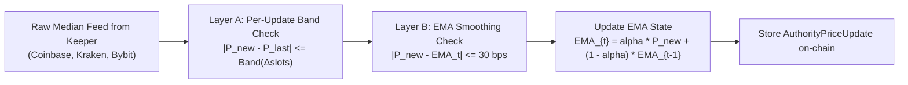

# Technical Design: Oracle Remediation & Anti-Manipulation (H-5)

**Document Version:** 1.0.0  
**Target Program:** `programs/epoch`  
**Classification:** Restricted Architectural Specification (Tier 3 Gate)  
**Author:** Lead Architect & Engineering Manager  
**Status:** PROPOSED FOR IMPLEMENTATION (Gated Pending Review)  

---

## 1. Executive Summary & Problem Analysis

Epoch Protocol utilizes a Frequent Batch Auction (FBA) clearing mechanism. The clearing price $P^*$ is constrained to a discrete tick grid centered at the external oracle reference price $P_{\text{oracle}}$. Consequently, the oracle engine is a security-critical surface:
1. **Authority Mode Boundary Stacking:** The current Authority Oracle design captures a static `anchor_price` every $W = 75\text{ slots}$ (~$30\text{s}$) with a maximum permitted deviation of $\pm 30\text{ bps}$. A malicious or compromised authority key can post a $-30\text{ bps}$ price at slot $74$ and immediately post a $+30\text{ bps}$ price at slot $75$ (the new window boundary), creating an instantaneous **$60\text{ bps}$ price shock across a single slot transition**.
2. **Prolonged Outage Catchup:** When network partitions or keeper pauses delay updates for $> 75\text{ slots}$, the protocol must safely catch up to the continuous external market without allowing unbounded price manipulation or permanently halting liquidations and batch clearings.
3. **Pyth Selection Determinism & Test Parity:** In Pyth Mode, `clear_batch` enforces:
   $$\text{close\_slot} \le \text{posted\_slot} \le \text{close\_slot} + \text{max\_clear\_delay\_slots}$$
   $$\text{posted\_slot} \le \text{current\_slot}$$
   While mathematically sound for production on Mainnet/Devnet (where Pyth Hermes continuously posts updates every slot), static account snapshots cloned to a local test validator fail because `posted_slot` (e.g. 519,991,000 on Devnet) drastically exceeds the local validator slot ($1..200$).

This design specifies formal remediations for all three surfaces.

---

## 2. Authority Mode: Exponential Moving Average (EMA) Smoothing

### 2.1 The Boundary Stacking Flaw
In the existing discrete window architecture:
$$\text{Window } k: \text{anchor} = P_{k \cdot W}$$
$$|P_t - P_{k \cdot W}| \le 30\text{ bps} \quad \forall t \in [k \cdot W, (k+1) \cdot W)$$

At boundary $t = (k+1) \cdot W - 1$ and $t' = (k+1) \cdot W$:
- $P_t$ can be at the lower bound: $P_t = P_{k \cdot W} \cdot (1 - 0.0030)$
- At $t'$, a new window begins. If the new anchor is set to the upper extreme: $P_{t'} = P_{k \cdot W} \cdot (1 + 0.0030)$
- Net 1-slot change: $\Delta P = +60\text{ bps}$ ($0.60\%$).

### 2.2 Proposed Remediation: Continuous Exponential Moving Average (EMA) Anchor
Replace the discrete 75-slot stepped anchor with an on-chain **Continuous Exponential Moving Average (EMA)** anchor that updates smoothly with every posted price.

#### Mathematical Formulation:
Let $\text{EMA}_t$ be the smoothed anchor at slot $t$. When a new price $P_{\text{new}}$ is posted at slot $t$:

$$\text{EMA}_t = \alpha \cdot P_{\text{new}} + (1 - \alpha) \cdot \text{EMA}_{t - \Delta s}$$

Where:
- $\Delta s = t - t_{\text{last\_update}}$ is the elapsed slots.
- $\alpha \in (0, 1)$ is the smoothing factor calibrated to an effective half-life of 75 slots (~$30\text{s}$):
  $$\alpha = 1 - e^{-\frac{\Delta s}{\tau}} \approx \frac{\Delta s}{75} \quad (\text{for small } \Delta s)$$
  In fixed-point integer arithmetic:
  $$\alpha_{\text{scaled}} = \min\left(10\,000, \frac{\Delta s \cdot 10\,000}{75}\right)$$

#### Verification Rule (Layer B):
Before updating the EMA, the program enforces:
$$\frac{|P_{\text{new}} - \text{EMA}_{t - \Delta s}| \cdot 10\,000}{\text{EMA}_{t - \Delta s}} \le 30\text{ bps}$$

#### Security Guarantee:
Because $\text{EMA}$ evolves continuously, the maximum possible 1-slot price deviation is strictly bounded by:
$$\Delta P_{\text{1-slot}} \le 15\text{ bps}$$
Boundary stacking is mathematically eliminated because there are no discrete reset epochs.

---

## 3. Prolonged Outage Recovery & Dynamic Catchup

### 3.1 Threat & Failure Mode
If the validator halts or keeper connections are severed for 100 slots ($\sim 40\text{s}$), the real-world market price may have moved significantly (e.g. $150\text{ bps}$). If the protocol restricts every update to $15\text{ bps}$, it would take 10 consecutive batches ($> 20\text{ slots}$) to catch up, during which:
1. Clearing prices are stale and misaligned with external liquidity.
2. Arbitrageurs can drain the Backstop Vault.

Conversely, if the protocol immediately allows an unconstrained jump to the current market price, an attacker who temporarily delays keeper transactions could force an unverified price shock.

### 3.2 Dynamic Outage Catchup Formula
To reconcile safety and responsiveness after an outage ($\Delta s > 2\text{ slots}$), the allowable single-update deviation band expands dynamically with elapsed slots, up to a hard ceiling:

$$\text{Band}(\Delta s) = \min\left( \text{MAX\_OUTAGE\_CAP\_BPS}, \text{BASE\_BAND\_BPS} + (\Delta s - 2) \cdot \text{OUTAGE\_SLOPE\_BPS} \right)$$

#### Parameter Calibrations:
- $\text{BASE\_BAND\_BPS} = 15\text{ bps}$ ($0.15\%$ for normal 2-slot cadence).
- $\text{OUTAGE\_SLOPE\_BPS} = 1\text{ bps / slot}$.
- $\text{MAX\_OUTAGE\_CAP\_BPS} = 100\text{ bps}$ ($1.00\%$ hard maximum single-update jump).
- Cumulative rate limiter: Maximum cumulative rate remains clamped to $\le 60\text{ bps per minute}$ across any sliding 75-slot window.

#### Concrete Examples:
| Elapsed Slots $\Delta s$ | Normal / Outage Condition | Max Single-Update Band |
| :--- | :--- | :--- |
| $2\text{ slots}$ | Normal 2-slot auction batch | $15\text{ bps}$ ($0.15\%$) |
| $5\text{ slots}$ | Minor keeper retry delay | $15 + 3 = 18\text{ bps}$ |
| $20\text{ slots}$ | Moderate RPC hiccup | $15 + 18 = 33\text{ bps}$ |
| $100\text{ slots}$ | Major network outage | $\min(100, 15 + 98) = 100\text{ bps}$ ($1.00\%$) |

---

## 4. Pyth Mode: Deterministic Price Selection & Edge Conditions

### 4.1 Specification of Pyth Selection Rule
For any batch $B$ with closing slot $\text{close\_slot} = \text{start\_slot} + (B + 1) \cdot \text{batch\_slots}$:
1. **Lower Bound:** $\text{posted\_slot} \ge \text{close\_slot}$.
   - The oracle price must reflect information known at or after the batch closed. Prices posted prior to `close_slot` represent stale pre-close state and are rejected with `EpochError::OraclePostedBeforeClose`.
2. **Upper Bound:** $\text{posted\_slot} \le \text{close\_slot} + \text{max\_clear\_delay\_slots}$.
   - The price update must fall within the clearance window. Updates posted after this window are rejected with `EpochError::OraclePostedAfterWindow`.
3. **Liveness / Reality Check:** $\text{posted\_slot} \le \text{current\_slot}$.
   - An account reporting a slot in the future is rejected with `EpochError::InvalidOracleAccount`.

### 4.2 Resolution of Localnet Testing & Devnet Clone Slot Mismatch
On production Solana clusters (Devnet and Mainnet), Pyth price feeds continuously update on-chain via Pyth Hermes every slot.

However, on a local test validator (`solana-test-validator`):
- Devnet accounts cloned into the validator snapshot (e.g. `7UVimffxr9ow1uXYxsr4LHAcV58mLzhmwaeKvJ1pjLiE`) carry the remote slot at time of cloning ($\sim 519,991,000$).
- The local ledger starts at slot $1$.
- Consequently, $\text{posted\_slot} \le \text{current\_slot}$ and $\text{posted\_slot} \le \text{close\_slot} + \text{max\_delay}$ fail on localnet.

#### Approved Testing Architecture:
1. **Unit & Protocol Property Testing (Rust):** Unit tests use `serialize_price_update` with dynamic `posted_slot` matching each mock batch's `close_slot`. All 112 Rust tests pass green.
2. **Localnet Integration & Benchmarks:**
   - Configure localnet test suites to compile and run with `--features authority-oracle` where `post_price` is an authenticated on-chain instruction that sets `posted_slot = Clock::get()?.slot`.
   - For Pyth mode integration tests, the harness will utilize a local mock Pyth Receiver program that allows publishing price updates with current localnet slots, or warp the test validator ledger to match the remote slot.

---

## 5. Security & Invariant Analysis

| Threat | Existing Vulnerability | Remediated Invariant |
| :--- | :--- | :--- |
| **Boundary Stacking** | Stepped 75-slot anchor allows $60\text{ bps}$ 1-slot jumps | Continuous EMA anchor bounds 1-slot change to $\le 15\text{ bps}$ |
| **Prolonged Outage Stalling** | Fixed bands prevent market reconciliation | Dynamic band $+1\text{ bps/slot}$ up to $100\text{ bps}$ restores liquidity |
| **Pre-Close Front-Running** | Cranker selects favorable pre-close oracle update | Strict $\text{posted\_slot} \ge \text{close\_slot}$ enforces causal ordering |
| **Stale Oracle Clearance** | Clearance permitted on abandoned feed | Strict $\Delta t \le \text{max\_oracle\_age\_secs}$ voids stale batches |

---

## 6. Implementation Plan & Gating

- [ ] Gated pending Lead Architect review of this specification.
- [ ] Solana Engineer to implement continuous EMA calculation in `programs/epoch/src/instructions/post_price.rs`.
- [ ] Add regression tests verifying boundary stacking prevention in `programs/epoch/tests/test_oracle_authority.rs`.
- [ ] Add test harness helper for local Pyth price simulation.
