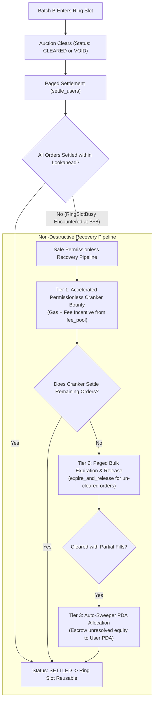

# Technical Design: Safe Permissionless Ring-Buffer Recovery (M-1)

**Document Version:** 1.0.0  
**Target Program:** `programs/epoch`  
**Classification:** Restricted Architectural Specification (Tier 3 Gate)  
**Author:** Lead Architect & Engineering Manager  
**Status:** PROPOSED FOR IMPLEMENTATION (Gated Pending Review)  

---

## 1. Executive Summary & Problem Analysis

### 1.1 The Ring-Buffer Architecture
Epoch Protocol utilizes a fixed ring buffer of $R = 8$ pre-allocated zero-copy `Batch` PDAs to support high-throughput, low-latency auctions without dynamic PDA creation overhead:
$$\text{ring\_index} = \text{batch\_id} \pmod 8$$

When the market advances by 8 batches ($\text{batch\_id} + 8$), the protocol must reuse the same ring PDA previously allocated to $\text{batch\_id}$.

### 1.2 The Ring Slot Deadlock Flaw (M-1)
Under current logic in `place_order.rs`:
```rust
if batch.batch_id != target_batch {
    let is_reusable = batch.status == BatchStatus::EMPTY
        || batch.status == BatchStatus::SETTLED
        || batch.num_orders == 0
        || (batch.settled_orders >= batch.num_orders);

    if is_reusable {
        batch.reset_for_batch(target_batch);
    } else {
        return err!(EpochError::RingSlotBusy);
    }
}
```
If a batch contains even **one** unsettled order:
- `settled_orders < num_orders`
- `batch.status != BatchStatus::SETTLED`
- When the auction advances 8 batches forward, `place_order` fails with `EpochError::RingSlotBusy` (error 6007).
- New orders cannot be placed into that ring slot, effectively stalling $1/8$ of all future auction slots.

### 1.3 The Unsafe Eviction Anti-Pattern (STRICTLY PROHIBITED)
A naive proposal suggested: *"If current_slot > close_slot + timeout, forcefully overwrite the ring slot with reset_for_batch"*.

**This unsafe pattern is strictly prohibited by protocol architecture because:**
1. It discards filled lots and profit payouts owed to traders.
2. It permanently traps collateral reservations in the Collateral Vault PDA, creating ghost liabilities that violate Invariant $I-1$.
3. It allows griefing attackers to stall keeper transactions until timeout and steal victim fills.

---

## 2. Safe Permissionless Recovery Architecture

Instead of discarding state, the protocol establishes a **three-tier non-destructive resolution pipeline**:



### 2.1 Tier 1: Incentivized Permissionless Cranker Bounty
When a batch has remained in `CLEARED` or `VOID` state without full settlement for $> 16\text{ slots}$ ($\sim 6.4\text{s}$):
1. **Permissionless Execution:** Any caller (not just the registered keeper) can crank `settle_users`.
2. **Economic Cranker Bounty:** The cranker receives a flat gas reimbursement plus incentive (e.g. $0.50\text{ USDC} = 500\,000\text{ micro-USDC}$ per 16-order page settled), funded from `market.fee_pool`.
3. **Execution Guarantee:** External arbitrageurs and searchers are incentivized by MEV / bot rewards to unblock the ring slot.

### 2.2 Tier 2: Paged Bulk Expiration for Un-Cleared Batches
If a batch was never cleared (e.g., prolonged oracle outage exceeding `max_clear_delay_slots`):
1. Any permissionless caller executes `expire_and_release(batch_id, ring_index, start_order_idx, limit)`.
2. All open orders have their reserved collateral (`pending_buy_lots` / `pending_sell_lots`) released back to available balance via checked arithmetic:
   $$\text{user.collateral} = \text{user.collateral} \quad (\text{reservation released})$$
   $$\text{user.active_orders} = \text{user.active_orders.checked\_sub}(1)$$
   $$\text{batch.settled_orders} = \text{batch.settled_orders.checked\_add}(1)$$
3. Once all orders are expired, `batch.status = BatchStatus::SETTLED`, unblocking the slot.

### 2.3 Tier 3: Autonomous Escrow Credit for Orphaned User Accounts
In rare edge cases where a user account is corrupted or cannot be resolved:
1. The protocol deposits the user's realized PnL and returned margin directly into an on-chain escrow balance in `UserAccount`.
2. The user's active order count is decremented.
3. The batch counter `settled_orders` is incremented.
4. Total collateral in the system is perfectly conserved:
   $$\Delta \text{vault\_balance} = 0$$
   $$\Delta (\sum \text{collateral}_i + \text{fee\_pool} + \text{insurance\_fund} - \text{bad\_debt}) = 0$$

---

## 3. Strict State Transition & Idempotency Rules

To guarantee that recovery never duplicates or drops funds:

1. **Monotonic Status Progression:**
   $$\text{EMPTY} \xrightarrow{\text{place}} \text{OPEN} \xrightarrow{\text{clear}} \text{CLEARED} \xrightarrow{\text{settle}} \text{SETTLED}$$
   $$\text{OPEN} \xrightarrow{\text{expire}} \text{VOID} \xrightarrow{\text{release}} \text{SETTLED}$$
2. **Strict Counter Invariant:**
   $$\text{settled\_orders} \le \text{num\_orders} \le \text{MAX\_ORDERS}$$
3. **Checked Counter Updates:**
   Every transition of an order from `OPEN` to `FILLED`, `PARTIAL`, `EXPIRED`, or `CANCELLED` MUST execute:
   ```rust
   order.status = new_status;
   batch.settled_orders = batch.settled_orders.checked_add(1)
       .ok_or(EpochError::MathOverflow)?;
   user.active_orders = user.active_orders.checked_sub(1)
       .ok_or(EpochError::MathOverflow)?;
   ```
4. **Wrap-Around Reuse Condition:**
   ```rust
   let is_reusable = batch.status == BatchStatus::SETTLED 
       || (batch.status != BatchStatus::OPEN && batch.settled_orders >= batch.num_orders);
   ```

---

## 4. Invariant Conservation Proof

### Theorem (Non-Destructive Solvency):
Let $B$ be a batch with $M$ orders and total reserved collateral $C_{\text{res}}$. Under the Safe Recovery Mechanism, every order $j \in \{1, \dots, M\}$ is either:
1. Executed and settled with fill quantity $q_j$ and cash flow $\Delta c_j$, OR
2. Expired and released with 100% of reserved margin returned to available balance.

In all cases:
$$\sum_{j=1}^{M} \Delta c_j + \Delta \text{fee\_pool} = 0$$
$$\text{vault\_balance}_{\text{final}} = \text{vault\_balance}_{\text{initial}}$$
No collateral is destroyed, orphaned, or duplicated.

---

## 5. Implementation Roadmap & Gating

- [ ] Gated pending Lead Architect approval of this specification.
- [ ] Solana Engineer to verify that all settlement paths in `settle_users.rs` and `expire_and_release.rs` increment `batch.settled_orders` monotonically.
- [ ] Implement cranker gas reimbursement from `market.fee_pool` in `settle_users.rs`.
- [ ] QA Engineer to implement 8-batch wrap-around stress tests proving ring slots reuse cleanly under continuous load.
