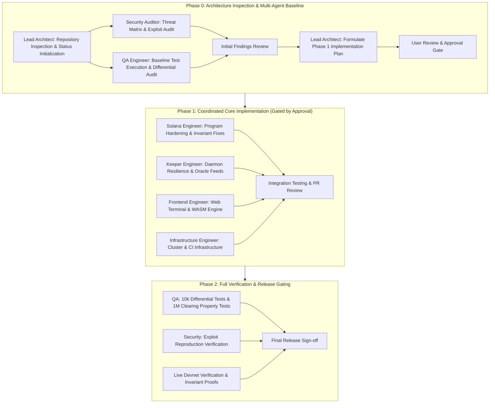

# Epoch Protocol — Multi-Agent Engineering Status & Coordination Board

**Lead Architect & Engineering Manager:** Lead Agent (`feat/epoch-multi-agent`)  
**Base Revision:** `7eda860` (`feat(oracle): add dual-layer rate and cumulative bounds, telemetry reconciliation, and local environment isolation`)  
**Timestamp:** 2026-11-08  
**Coordination Protocol:** Git Worktree Multi-Agent Model  

---

## 1. Multi-Agent Team Roster & Worktree Mapping

| Role | Worktree Path | Active Branch | Base Commit | Current Status |
| :--- | :--- | :--- | :--- | :--- |
| **Lead Architect & Engineering Manager** | `.` (Root) | `feat/epoch-multi-agent` | `7eda860` | **Active** (Repository Inspection Complete; Coordinating Agents) |
| **Security Auditor** | `../Epoch-security` | `agent/security-audit` | `7eda860` | **In Progress** (Initial Security Audit & Exploit Vector Analysis) |
| **Solana Engineer** | `../Epoch-solana` | `agent/solana-engineer` | `7eda860` | **Pending** (Awaiting Phase 1 Implementation Plan Approval) |
| **Keeper Engineer** | `../Epoch-keeper` | `agent/keeper-engineer` | `7eda860` | **Pending** (Awaiting Phase 1 Implementation Plan Approval) |
| **Frontend Engineer** | `../Epoch-frontend` | `agent/frontend-engineer` | `7eda860` | **Pending** (Awaiting Phase 1 Implementation Plan Approval) |
| **Infrastructure Engineer** | `../Epoch-infra` | `agent/infrastructure-engineer` | `7eda860` | **Pending** (Awaiting Phase 1 Implementation Plan Approval) |
| **QA Engineer** | `../Epoch-qa` | `agent/qa-engineer` | `7eda860` | **In Progress** (Baseline Test Execution & Differential Suite Audit) |

---

## 2. Agent Assignments, Tasks & Testing Requirements

### 2.1 Lead Architect & Engineering Manager
- **Branch:** `feat/epoch-multi-agent`
- **Worktree:** `.` (Epoch Main Workspace)
- **Assigned Tasks:**
  1. Inspect complete repository (Anchor program, Keeper daemon, Frontend client, Reference clearing engine, APIs, tests).
  2. Coordinate 6 specialized engineering agents in their dedicated worktrees.
  3. Validate findings and implementation proposals submitted by Security and QA.
  4. Formulate the comprehensive Phase 1 Implementation Plan for user approval.
  5. Review integration PRs, manage merge order, and verify zero regression across invariants ($I-1$ to $I-12$).
  6. Track commit hashes, worktree status, and release gating criteria.
- **Dependencies:** None.
- **Testing Requirements:** Full workspace verification (`cargo test --workspace`, `cargo test --workspace --features authority-oracle`).

---

### 2.2 Security Auditor
- **Branch:** `agent/security-audit`
- **Worktree:** `../Epoch-security`
- **Assigned Tasks:**
  1. Comprehensive audit of on-chain program (`programs/epoch`):
     - Invariants $I-1$ through $I-12$ mathematical conservation and rounding drift.
     - Privilege and authorization controls on all instructions (`update_market_params`, `update_vault_params`, `post_price`, `clear_batch`, `settle_users`, `expire_and_release`).
     - Overflow/underflow checks, casting safety, and zero-copy account boundary safety.
     - PDA derivation integrity and account replacement/substitution vulnerabilities.
     - Oracle attack vectors: staleness, wide confidence exploitation, timestamp manipulation, and price jump abuse.
     - Economic exploit vectors: front-running batch closure, ring buffer starvation, griefing `expire_and_release`, liquidation front-running.
  2. Execute and expand exploit reproduction suite in `tests/exploits.ts`.
  3. Deliver Initial Security Audit Report and threat matrix.
- **Dependencies:** None (initial review commences on base commit `7eda860`).
- **Testing Requirements:**
  - `bun run tests/exploits.ts`
  - Property-based safety tests (`programs/epoch/tests/property_invariants.rs`)
  - Safe conversion and overflow verification (`programs/epoch/tests/test_safe_conversions.rs`)

---

### 2.3 QA Engineer
- **Branch:** `agent/qa-engineer`
- **Worktree:** `../Epoch-qa`
- **Assigned Tasks:**
  1. Establish test baseline across all existing suites (Rust unit/integration, Anchor TS, differential, and simulation).
  2. Audit differential clearing test framework (`crates/epoch-ref` vs `programs/epoch`):
     - Verify 1,000,000 randomized batch property tests.
     - Verify 10,000 differential clearing test cases (`tests/differential.rs`).
  3. Audit end-to-end integration and lifecycle tests (`tests/epoch.ts`, `scripts/test_local_e2e.ts`, `scripts/test_fault_injection_e2e.ts`).
  4. Stress-test edge cases:
     - Marginal tick pro-rata allocation and deterministic dust distribution.
     - Zero-volume batch clearing and funding rate accumulation at oracle parity.
     - Ring buffer wrap-around, reuse, and busy slot collisions.
     - Multi-page user settlement ($>16$ users/batch).
  5. Deliver Initial QA & Testing Findings Report detailing test coverage gaps and recommended test additions.
- **Dependencies:** None (initial review commences on base commit `7eda860`).
- **Testing Requirements:**
  - `cargo test --workspace`
  - `cargo test --workspace --features authority-oracle`
  - `bun run test:local:e2e` (with local validator)
  - `bun run scripts/test_golden_vectors.ts`

---

### 2.4 Solana Engineer
- **Branch:** `agent/solana-engineer`
- **Worktree:** `../Epoch-solana`
- **Assigned Tasks:**
  1. Anchor program architecture stewardship (`programs/epoch`).
  2. Zero-copy Borsh account optimization (`Batch`, `Market`, `UserAccount`).
  3. Compute Unit (CU) profiling and optimization across `clear_batch`, `settle_users`, `vault_quote`, and `liquidate`.
  4. Implement contract fixes identified by Security Auditor and QA Engineer.
  5. Ensure strict compliance with Solana memory alignment (8-byte / 16-byte boundaries) and account size ceilings ($\le 10,240$ bytes for PDA init).
- **Dependencies:** Security Auditor findings + QA baseline report + Approved Phase 1 Implementation Plan.
- **Testing Requirements:**
  - `anchor build`
  - `cargo test --package epoch`
  - CU profiling scripts (`scripts/landing_test.ts`)

---

### 2.5 Keeper Engineer
- **Branch:** `agent/keeper-engineer`
- **Worktree:** `../Epoch-keeper`
- **Assigned Tasks:**
  1. Keeper daemon reliability and liveness optimization (`keeper/src/keeper.ts`).
  2. Dual-mode oracle integration:
     - Pyth Mode: Hermes streaming, keyless rate-limiting ($\le 10\text{ reqs}/10\text{s}$), binary price posting, CU calibration.
     - Authority Mode: Multi-venue L1 book-ticker WebSocket feeds (Kraken, Bybit, Backpack, Binance), 3-venue quorum, $30\text{ bps}$ outlier dropping, dual-layer rate bounds ($15\text{ bps}$ base, $60\text{ bps/min}$ cumulative).
  3. Paged settlement crank orchestration ($\le 16$ users/tx).
  4. Priority fee dynamic calibration and compute unit margin enforcement.
  5. Backstop Vault quoting crank and Avellaneda-Stoikov inventory skew execution.
- **Dependencies:** Solana program interface alignment + Approved Phase 1 Implementation Plan.
- **Testing Requirements:**
  - `cd keeper && bun run test`
  - `bun run scripts/oracle/test_aggregator_logic.ts`
  - Local validator keeper crank integration

---

### 2.6 Frontend Engineer
- **Branch:** `agent/frontend-engineer`
- **Worktree:** `../Epoch-frontend`
- **Assigned Tasks:**
  1. Headless trading web terminal UI (`app/src/app` & `app/src/components`).
  2. Client-side auction preview engine synchronization (`clearingEngine.ts`, `epoch_ref.wasm`).
  3. Real-time crossing curves (`BatchAuctionCrossingCurve.tsx`), depth ladders, and order tickets.
  4. Oversize order depth guards and partial fill warnings.
  5. RPC failure resilience and banner state management without synthetic price fabrication.
  6. Invariant evidence and telemetry dashboard (`EvidenceView.tsx`).
- **Dependencies:** IDL synchronization from Solana Engineer + Approved Phase 1 Implementation Plan.
- **Testing Requirements:**
  - `cd app && bun run build`
  - `cd app && bun test`
  - Playwright visual verification (`scripts/verify_ux3_playwright.ts`)

---

### 2.7 Infrastructure Engineer
- **Branch:** `agent/infrastructure-engineer`
- **Worktree:** `../Epoch-infra`
- **Assigned Tasks:**
  1. Local validator orchestration (`scripts/local_up.ts`, `scripts/local_down.ts`).
  2. Devnet deployment, market initialization, and collateral funding automation (`scripts/init_fresh_market.ts`).
  3. Telemetry and metrics capture (`scripts/oracle/telemetry_10min.ts`, `scripts/measure_devnet_slot_time.ts`).
  4. Docker container build configurations (`docker/bun.Dockerfile`, `docker-compose.yml`).
  5. Snapshot export and evidence archival pipeline (`scripts/export_snapshot.ts`).
- **Dependencies:** Approved Phase 1 Implementation Plan.
- **Testing Requirements:**
  - `bun run local:up` & health check
  - `bun run scripts/preflight.ts`
  - Docker container build verification

---

## 3. Implementation Phasing & Workflow Protocol

---

## 4. Current Worktree Branches & Commit Tracking

| Agent / Worktree | Branch | Current Commit | Last Commit Subject | Status |
| :--- | :--- | :--- | :--- | :--- |
| **Lead Architect** (`Epoch`) | `feat/epoch-multi-agent` | `7eda860` | feat(oracle): add dual-layer rate and cumulative bounds... | **Inspecting & Coordinating** |
| **Security Auditor** (`Epoch-security`) | `agent/security-audit` | `7eda860` | feat(oracle): add dual-layer rate and cumulative bounds... | **Conducting Audit** |
| **Solana Engineer** (`Epoch-solana`) | `agent/solana-engineer` | `7eda860` | feat(oracle): add dual-layer rate and cumulative bounds... | **Standby** |
| **Keeper Engineer** (`Epoch-keeper`) | `agent/keeper-engineer` | `7eda860` | feat(oracle): add dual-layer rate and cumulative bounds... | **Standby** |
| **Frontend Engineer** (`Epoch-frontend`) | `agent/frontend-engineer` | `7eda860` | feat(oracle): add dual-layer rate and cumulative bounds... | **Standby** |
| **Infrastructure Engineer** (`Epoch-infra`) | `agent/infrastructure-engineer` | `7eda860` | feat(oracle): add dual-layer rate and cumulative bounds... | **Standby** |
| **QA Engineer** (`Epoch-qa`) | `agent/qa-engineer` | `7eda860` | feat(oracle): add dual-layer rate and cumulative bounds... | **Testing Baseline** |

---

## 5. Next Milestones & Immediate Actions
1. **Security Auditor:** Complete review of on-chain instructions, PDA security, and exploit reproduction suite; submit initial security findings.
2. **QA Engineer:** Complete baseline run of all test suites, audit test vector coverage, and submit initial QA findings.
3. **Lead Architect:** Synthesize findings, validate design constraints, and present comprehensive **Phase 1 Implementation Plan** for User approval before feature implementation begins.
