# Oracle Modes & Trust Architecture

**Protocol Version:** v1  
**Supported Oracle Modes:**  
1. **Pyth Mode** (Default Production Mode)  
2. **Authority Mode** (Local Testing & Development Mode, compile-time feature `authority-oracle`)

---

## 1. Architectural Comparison

```mermaid
flowchart TD
    subgraph Pyth_Mode["1. Pyth Mode (Default Production Build)"]
        A1["Pyth Hermes / Wormhole Guardians"] -->|"Signed VAA / Update"| A2["Pyth Solana Receiver Program<br/>(rec5EKMGg...LtFJ)"]
        A2 -->|"Write PriceUpdateV2"| A3["Pyth Price Account<br/>(7UVimffx...LiE)"]
        A3 -->|"verify_price_update_strict"| A4["Epoch Engine<br/>(clear_batch / liquidate)"]
        A4 -->|"Enforce Quorum, Age, Conf"| A5["Match & Settle"]
    end

    subgraph Authority_Mode["2. Authority Mode (Feature: authority-oracle)"]
        B1["6 Exchange L1 Feeds<br/>(Coinbase, Kraken, Bybit, etc.)"] -->|"WebSocket Tickers"| B2["Multi-Venue Median Aggregator<br/>(Keeper Service)"]
        B2 -->|"Quorum >= 3 & Outlier Filter"| B3["post_price Instruction<br/>(Signed by oracle_authority)"]
        B3 -->|"Write AuthorityPriceUpdate PDA"| B4["Epoch Oracle PDA<br/>seeds: ['oracle', market]"]
        B4 -->|"verify_price_update_strict_with_market"| B5["Epoch Engine<br/>(clear_batch / liquidate)"]
        B5 -->|"Match & Settle"| B6["Settled"]
    end
```

---

## 2. Feature & Technical Specification

| Feature / Dimension | Pyth Mode (`default`) | Authority Mode (`--features authority-oracle`) |
| :--- | :--- | :--- |
| **Cargo Feature Flag** | None (default build) | `authority-oracle` |
| **Instruction Set** | Standard instruction set (`post_price` does NOT exist) | Exposes `post_price` on-chain instruction |
| **Price Feed Source** | Pyth Solana Receiver Program (`PriceUpdateV2`) | Program-owned PDA (`AuthorityPriceUpdate`) |
| **Feed Program ID** | `rec5EKMGg6MxZYaMdyBfgwp4d5rB9T1VQH5pJv5LtFJ` | `ER8SSfvp7roW6asG429Uv3mHY1aEd1jxGBdigLu27284` (Epoch ID) |
| **On-Chain Cryptographic Verification** | Wormhole Guardian Quorum (`VerificationLevel::Full`) | Ed25519 signature by `market.oracle_authority` |
| **Key Separation** | None (Permissionless keeper posts signed Pyth VAAs) | `oracle_authority` strictly separate from `admin` |
| **Max Price Jump Bound** | Managed by Pyth publisher consensus | **Layer A (Per-Update Band):** $15\text{ bps}$ ($0.15\%$) base for $\le 2$ slots; $+1\text{ bps/slot}$ pause allowance; hard single-update cap $100\text{ bps}$ ($1.00\%$). **Layer B (Cumulative Anchor Bound):** Anchor cadence $W = 75\text{ slots}$ (~$30\text{s}$); max deviation from anchor $\le 30\text{ bps}$ ($0.30\%$), enforcing a cumulative bound of **$60\text{ bps/min}$** ($300\text{ bps}$ in 5 min). |
| **Outage Recovery Bound** | Automatic upon Pyth feed resumption | Single-update recovery capped at $\min(15 + (\Delta \text{slots} - 2), 100)\text{ bps}$; cumulative movement strictly constrained to $\le 60\text{ bps/min}$ |
| **Clear Window Enforcement** | `close_slot <= posted_slot <= close_slot + max_clear_delay` | Same identical rule enforced |
| **Staleness Bound** | Timestamp age $\le \text{max\_oracle\_age\_secs}$ (10s) | Same identical rule enforced (max price age 3s for median inclusion; on-chain staleness $\le 10$s) |
| **Confidence Ratio Bound** | Confidence $\le 20\text{ bps}$ of price | Same identical rule enforced; rejects $\text{conf} = 0$ (cross-venue dispersion metric) |

---

## 3. Trust Assumptions & Threat Models

### 3.1 Pyth Mode (Decentralized & Trust-Minimized)
- **Trust Assumption:** Relies on the distributed network of Pyth price publishers and the Wormhole guardian cryptographic signature threshold ($> 2/3$ quorum).
- **Threat Mitigation:**
  - Spoofed accounts rejected via on-chain `require_keys_eq!(*owner, PYTH_RECEIVER_PROGRAM_ID)`.
  - Stale prices rejected via timestamp and slot freshness bounds.
  - Price manipulations rejected by guardian quorum checks (`VerificationLevel::Full`).
  - No permissioned key can unilaterally set a price or force an artificial liquidation.

### 3.2 Authority Mode (Centralized Testing Mode)
- **Trust Assumption:** Relies entirely on the honesty, availability, and cryptographic security of the `market.oracle_authority` keypair.
- **Threat Mitigation:**
  - **Key Separation:** `market.admin` (market authority) CANNOT post prices. If the admin calls `post_price`, the transaction fails with `EpochError::Unauthorized`.
  - **Layered Rate & Cumulative Movement Bounds:**
    - *Layer A (Per-Update Band):* Typical 2-slot updates are bounded by a tight normal band of $15\text{ bps}$ ($0.15\%$). If keeper pauses or slots drop, an incremental pause allowance of $+1\text{ bps/slot}$ applies beyond 2 slots, subject to a hard single-update cap of $100\text{ bps}$ ($1.00\%$).
    - *Layer B (Cumulative Anchor Bound):* A slower anchor price is captured on-chain every $W = 75\text{ slots}$ (~$30\text{s}$). Within any 75-slot window, the price cannot deviate from `anchor_price` by more than $30\text{ bps}$ ($0.30\%$). This bounds sustained price movement to an absolute ceiling of **$60\text{ bps per minute}$** ($300\text{ bps}$ over 5 minutes), mathematically preventing an aggressive or compromised key from walking the clearing price arbitrarily across consecutive slots.
  - **No Zero Confidence:** Rejects $\text{conf} = 0$, enforcing non-zero risk spreads.

### 3.3 Oracle "Confidence" vs. Error Bounds & Failure Modes
In both Pyth and Authority Oracle modes, the reported on-chain metric `conf` represents **cross-venue dispersion** (the spread or inter-quartile difference across observed venue mid prices), **NOT a mathematical bound on true price error**.

#### Crucial Distinctions:
1. **Dispersion $\neq$ Absolute Accuracy:** A low confidence value (e.g. $\pm 0.02\text{ USD}$ or $1.5\text{ bps}$) indicates that the sampled reporting venues currently agree with each other. It does **not** prove that the observed consensus price equals the true, unmanipulated external liquidation value of SOL.
2. **What Cross-Venue Dispersion Does NOT Capture:**
   - **Common-Mode Latency Lag:** During rapid global price discovery events (e.g. high-frequency liquidation cascades originating on major offshore futures books), multiple spot WebSocket feeds can experience simultaneous ingestion or network transmission delays. All reporting venues may update with the same 500ms–2000ms delay, producing exceptionally tight cross-venue agreement (artificially "tight confidence") while substantially lagging the real-time continuous market.
   - **Venue Outages & Loss of Independent Sources:** If network partitions, WebSocket dropouts, or exchange maintenance knock out independent primary venues (e.g., Kraken or Coinbase), the active median quorum may fall back to remaining venues that share common liquidity providers or cross-hedged algorithmic market makers (e.g., Binance and Bybit order books quoting identical spreads). The observed dispersion will appear narrow even though independent price discovery has degraded.
   - **Correlated Toxic Quotes:** If top market makers pull liquidity or skew quotes simultaneously across all connected venues prior to major macroeconomic releases, book-ticker midpoints will widen or shift uniformly without triggering outlier ejection, concealing true market illiquidity.
   - **Regional Endpoint Throttling:** Exchange rate limits or cloud provider network degradation may desynchronize order book snapshots, causing the aggregator to read slightly desynchronized quotes that artificially fluctuate confidence.

---

## 4. Permitted Claims & Marketing Guidelines

To ensure factual integrity and prevent misleading representations, the following boundaries govern all documentation, UI messaging, and public statements:

### ✅ Permitted Claims:
- *"Pyth Mode enforces cryptographic Wormhole guardian quorum verification and strict staleness bounds on Solana."*
- *"Authority Mode combines real-time L1 book-ticker feeds across 6 major crypto exchanges to compute a resilient median clearing price for local benchmarking."*
- *"Epoch isolates `oracle_authority` from the administrative upgrade authority, preventing admin price tampering."*

### ❌ Strictly Prohibited Claims:
- **NEVER** claim Authority Mode is "decentralized", "trustless", or "tamper-proof". (Authority Mode is centralized and relies on the authority key).
- **NEVER** claim the UI or keeper "complies with exchange data terms". (Redistribution of derived data without institutional licensing is strictly prohibited by major exchange agreements).
- **NEVER** deploy Authority Mode to Mainnet. Mainnet builds must strictly compile with default Pyth mode.
