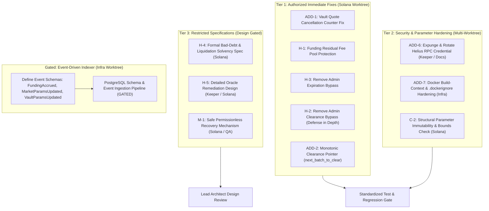

# Epoch Protocol — Phase 1 Revised Authorization & Execution Charter

**Lead Architect & Engineering Manager:** Lead Agent (`feat/epoch-multi-agent`)  
**Base Revision:** `7eda860`  
**Latest Revision:** `eb537f0`  
**Status:** **OFFICIALLY AUTHORIZED (Executive Approval Gate)**  
**Date:** November 2026  

---

## 1. Executive Authorization Matrix

Following the evaluation of the baseline findings, the Lead Architect has updated the implementation authorization into three distinct tiers:
1. **Tier 1 (Authorized Immediate Core Fixes):** Strictly verified bug fixes with zero financial side-effects.
2. **Tier 2 (Authorized Security Hygiene & Parameter Hardening):** Credential expungement, container isolation, and parameter immutability.
3. **Tier 3 (Restricted Architectural Specifications):** Requires formal mathematical or architectural specifications prior to any code implementation.



---

## 2. Immediate Fix Specifications (Tier 1)

### 2.1 [ADD-1] Idempotent Vault Quote Cancellation Accounting
- **Target File:** `programs/epoch/src/instructions/vault_quote.rs#L185-L206`
- **Owner:** Solana Engineer (`agent/solana-engineer`)
- **Requirements:**
  1. In `vault_quote.rs`, when resting quotes are cancelled on disallowed sides:
     - Set `batch.orders[i].status = OrderStatus::CANCELLED;`
     - Increment `batch.settled_orders = batch.settled_orders.saturating_add(1);` exactly once per cancelled order.
     - Decrement `vault_user.active_orders = vault_user.active_orders.saturating_sub(1);` exactly once per cancelled order.
     - Release pending lot reservations: `pending_buy_lots.saturating_sub(lots)` or `pending_sell_lots.saturating_sub(lots)`.
     - Decrement tick aggregate arrays: `bid_qty[tick].saturating_sub(lots)` or `ask_qty[tick].saturating_sub(lots)`.
  2. **Idempotency Guarantee:** Cancellation executes only if `o.status == OrderStatus::OPEN`. Subsequent executions on the same batch do not re-cancel or double-increment.
  3. **Regression Tests Required:**
     - Test BUY quote cancellation when inventory hits short limit.
     - Test SELL quote cancellation when inventory hits long limit.
     - Test repeated `vault_quote` invocations on the same batch (verify idempotency).
     - Test ring slot reuse ($B + 8$) after 8 batches to verify zero `RingSlotBusy` regression.

### 2.2 [H-1] Funding Residual Isolation & Fee Pool Protection
- **Target Files:** `programs/epoch/src/instructions/settle_users.rs#L211-L225` and `expire_and_release.rs#L179-L191`
- **Owner:** Solana Engineer (`agent/solana-engineer`)
- **Requirements:**
  1. Negative funding residuals resulting from paged settlements ($\le 16$ users/tx) must **never** debit `market.fee_pool` below zero.
  2. Implement saturating deduction on `fee_pool` or isolate funding residual crediting to non-negative values.
  3. Invariant $I-1$ verification: Document that fractional micro-USDC integer roundings do not cause quote ledger drift.
  4. **Regression Tests Required:**
     - Execute `settle_users` on a single-user page with net funding receivable when `market.fee_pool == 0`. Verify transaction succeeds without `MathOverflow`.

### 2.3 [H-2 & H-3] Removal of Administrative Timing Bypasses
- **Target Files:**
  - `programs/epoch/src/instructions/clear_batch.rs#L108-L111`
  - `programs/epoch/src/instructions/expire_and_release.rs#L64-L68`
- **Owner:** Solana Engineer (`agent/solana-engineer`)
- **Requirements:**
  1. In `clear_batch.rs`, remove `|| market.admin == ctx.accounts.cranker.key()`.
  2. In `expire_and_release.rs`, remove `|| market.admin == ctx.accounts.caller.key()`.
  3. Auctions must remain 100% deterministic and permissionless: clearance strictly requires `current_slot >= close_slot`; voiding strictly requires `current_slot > close_slot + max_clear_delay_slots`.
  4. **Regression Tests Required:**
     - Calling `clear_batch` as admin before `close_slot` fails with `BatchNotOpen`.
     - Calling `expire_and_release` as admin before staleness window fails with `BatchNotStale`.

### 2.4 [ADD-2] Monotonic Clearance Counter Enforcement
- **Target File:** `programs/epoch/src/instructions/clear_batch.rs#L175-L185`
- **Owner:** Solana Engineer (`agent/solana-engineer`)
- **Requirements:**
  1. Ensure `market.next_batch_to_clear` updates monotonically:
     ```rust
     market.next_batch_to_clear = market.next_batch_to_clear.max(batch_id + 1);
     ```
  2. Prevents out-of-order clearance or voiding operations from rolling the market clearance pointer backward.

---

## 3. Security Hygiene & Parameter Hardening (Tier 2)

### 3.1 [ADD-6] Credential Sanitization & Rotation
- **Owner:** Keeper Engineer & Infrastructure Engineer
- **Requirements:**
  1. Expunge hardcoded Helius API key (`7f051d79-ac86-4394-bae9-346f64974d1a`) from `docs/KEEPER_RUNBOOK.md` (lines 117 and 177).
  2. Replace with generic environment variable references (`<HELIUS_API_KEY>`).
  3. Issue a revocation request for the exposed API key in the Helius Developer Console.
  4. Ensure `.env` and `keeper-keypair.json` remain completely untracked in `.gitignore`.

### 3.2 [ADD-7] Docker Secret & Context Hardening
- **Owner:** Infrastructure Engineer (`agent/infrastructure-engineer`)
- **Requirements:**
  1. Create `.dockerignore` in workspace root excluding `.git/`, `.env`, `*.json` keypairs, `target/`, and node modules.
  2. In `docker-compose.yml`, remove fallback references to the program deployment keypair.
  3. Update `docker/bun.Dockerfile` to copy only necessary production dependencies.

### 3.3 [C-2] Market Parameter Immutability & Safety Bounds
- **Target File:** `programs/epoch/src/instructions/update_market_params.rs`
- **Owner:** Solana Engineer (`agent/solana-engineer`)
- **Requirements:**
  1. Disallow dynamic modification of structural market dimensions on an active market:
     - `require_eq!(new_params.batch_slots, current_params.batch_slots, EpochError::ImmutableParameter);`
     - `require_eq!(new_params.base_lot, current_params.base_lot, EpochError::ImmutableParameter);`
     - `require_eq!(new_params.k_ticks, current_params.k_ticks, EpochError::ImmutableParameter);`
  2. Enforce strict upper safety caps on risk parameters:
     - `new_params.liq_penalty_bps <= 500` (max 5%).
     - `new_params.funding_cap_bps <= 500` (max 5%).
     - `new_params.fee_bps <= 50` (max 0.5%).

---

## 4. Restricted Architectural Specifications (Tier 3)

The following three architectural areas are **STRICTLY GATED**. No code implementation may begin until the following formal specifications are reviewed and approved by the Lead Architect.

### 4.1 [H-4] Formal Bad-Debt & Liquidation Solvency Specification
- **Assigned Architect:** Solana Engineer (`agent/solana-engineer`)
- **Scope & Required Analysis:**
  1. **Partial Liquidation Mechanics:** Define mathematical formula for liquidating only the lot quantity necessary to bring account equity back to MMR, minimizing market impact.
  2. **Remaining User Obligations:** Specify how remaining unliquidated lots and margin are handled when vault absorption is partial.
  3. **Backstop Vault Capacity:** Formalize vault inventory boundary:
     $$\text{available\_capacity} = \text{max\_inventory\_lots} - |\text{vault\_base\_position}|$$
     and collateral solvency threshold:
     $$\text{vault\_equity} \ge \text{required\_maintenance\_margin}$$
  4. **Insurance Fund & Deficit Socialization:**
     $$\text{absorbed\_deficit} = \min(\text{liquidation\_deficit}, \text{insurance\_fund})$$
     $$\Delta \text{bad\_debt} = \text{liquidation\_deficit} - \text{absorbed\_deficit}$$
  5. **Conservation Invariant Proof:** Formally prove that Invariant $I-1$ holds under bad debt:
     $$\sum_{\text{users}} (C_i + Q_i) + \text{fee\_pool} + \text{insurance\_fund} - \text{bad\_debt} \equiv \text{vault\_spl\_balance}$$

### 4.2 [H-5] Oracle Hardening & Deterministic Selection Design
- **Assigned Architect:** Keeper Engineer & Solana Engineer
- **Scope & Required Analysis:**
  1. **Authority Mode Smoothing:** Design continuous sliding window or exponential moving average (EMA) to eliminate boundary stacking at the 75-slot anchor boundary.
  2. **Prolonged Outage Catchup:** Provide mathematical catchup formula allowing price recovery following network disconnects without exceeding safety bounds:
     $$\text{max\_jump} = \min(15\text{ bps} + (\Delta \text{slots} - 2)\times 1\text{ bps}, 100\text{ bps})$$
  3. **Pyth Mode Determinism:** Enforce on-chain that `clear_batch` accepts only the earliest valid `PriceUpdateV2` landed on or after `close_slot`, removing cranker selection optionality.

### 4.3 [M-1] Safe Permissionless Ring-Buffer Recovery Mechanism
- **Assigned Architect:** Solana Engineer & QA Engineer
- **Scope & Required Analysis:**
  1. **No-Discard Rule:** Reaffirm that timeout-based eviction discarding unsettled orders is strictly prohibited (violates Invariant $I-1$, $I-4$, and risks trader capital).
  2. **Permissionless Settlement Incentives:** Design cranker incentives or batched multi-order settlement helpers to guarantee that stale batches can always be cleared and settled by any network participant.

---

## 5. Event Standardization & Indexer Architecture

To ensure clean coordination between the Solana and Infrastructure engineers, database schema creation is **GATED** until event contracts are finalized:

### 5.1 Standardized Event Naming: `FundingAccrued`
- **Resolution:** Standardize on **`FundingAccrued`** (rejecting `FundingUpdated` as ambiguous). Funding represents an accrual process calculated continuously from batch clearing offsets.

### 5.2 Required Event Payloads (On-Chain Contract)

```rust
/// Emitted upon batch clearance when funding index is updated.
#[event]
pub struct FundingAccrued {
    pub batch_id: u64,
    pub slot: u64,
    pub clearing_price: u64,
    pub oracle_price: u64,
    pub offset_bps: i16,
    pub funding_rate_bps: i16,
    pub funding_index: i128,
    pub accrual_amount: i128,
}

/// Emitted when governance updates market risk parameters.
#[event]
pub struct MarketParamsUpdated {
    pub admin: Pubkey,
    pub slot: u64,
    pub old_params: MarketParams,
    pub new_params: MarketParams,
}

/// Emitted when governance updates Backstop Vault parameters.
#[event]
pub struct VaultParamsUpdated {
    pub admin: Pubkey,
    pub slot: u64,
    pub old_params: VaultParams,
    pub new_params: VaultParams,
}
```

---

## 6. Comprehensive Test Verification Matrix

### 6.1 Reconciled Test Counts Breakdown

| Test Metric | Exact Count | Scope & Included Test Suites | Command |
| :--- | :---: | :--- | :--- |
| **Functional Integration Tests** | **37** | 8 specific test suites: bounds (17), safe conversions (4), clearing ladder (4), zero volume (2), order buffer (2), orphan pending (2), token mint (1), funding seconds (5). | `cargo test --test test_parameter_bounds ...` |
| **Oracle Selection Group** | **43** | Functional group (37) + `test_oracle_selection_and_staleness.rs` (6). | Targeted Cargo test run |
| **Default Workspace Total** | **105** | Entire workspace under default features: 23 unit (`epoch`), 14 unit (`epoch-ref`), 68 integration across all 18 test harnesses. | `cargo test --workspace` |
| **Authority Oracle Workspace**| **107** | Workspace with `--features authority-oracle`: 105 - 5 (Pyth specific) + 7 (`test_authority_oracle_mode`) = 107. | `cargo test --workspace --features authority-oracle` |
| **Total Test Function Surface** | **112** | All unique test functions implemented in the Rust codebase (105 default + 7 authority oracle). | Complete source inspection |

### 6.2 Standardized Commands & Quality Gates

```bash
# Rust Workspace Default (105 tests)
cargo test --workspace

# Rust Workspace Authority Mode (107 tests)
cargo test --workspace --features authority-oracle

# Frontend Unit & Parity (2 tests)
cd app && bun test

# Keeper Daemon Unit (4 tests)
cd keeper && bun test
```

### 6.3 Anchor Integration Unblocking Tasks (QA Engineer)
1. `Anchor.toml`: Add `bind_address = "127.0.0.1"` under `[test.validator]`.
2. `tests/epoch.ts#L133`: Change `const oracleAuthKeypair = Keypair.generate();` to `anchor.web3.Keypair.generate();`.
3. Synchronize `target/deploy/epoch-keypair.json` with `epoch.config.json`.
4. Execute full Anchor suite: `anchor test` (all 30+ tests passing).

---

## 7. Multi-Agent Git Workflow Protocol

Every engineering agent must adhere to the following strict Git rules:
1. **Branch Isolation:** Execute work only in the worktree corresponding to your assigned branch (`agent/*`). Never commit directly to `main` or other agent branches.
2. **Pre-Flight Inspection:** Execute `git status` prior to editing to confirm clean working tree.
3. **Scoped Commits:** Stage only modified files directly related to your assigned issue. Never stage keypairs, `.env`, or secrets.
4. **Mandatory Local Testing:** Run the standardized test command (`cargo test --workspace` or `bun test`) before staging.
5. **Pre-Commit Diff Review:** Execute `git diff --cached` and inspect all changes prior to committing.
6. **Conventional Commits:** Use standardized prefixes:
   - `fix(contract): resolve ADD-1 quote cancellation counter leak`
   - `fix(contract): eliminate negative funding fee_pool underflow in settle_users`
   - `sec(auth): remove administrative bypasses from clear_batch and expire_and_release`
   - `test(anchor): unblock Anchor test suite keypair derivation and validator binding`
7. **No Remote Pushes:** Never run `git push` or `git push --force`. Remote pushes are handled exclusively by the Lead Architect / User.
